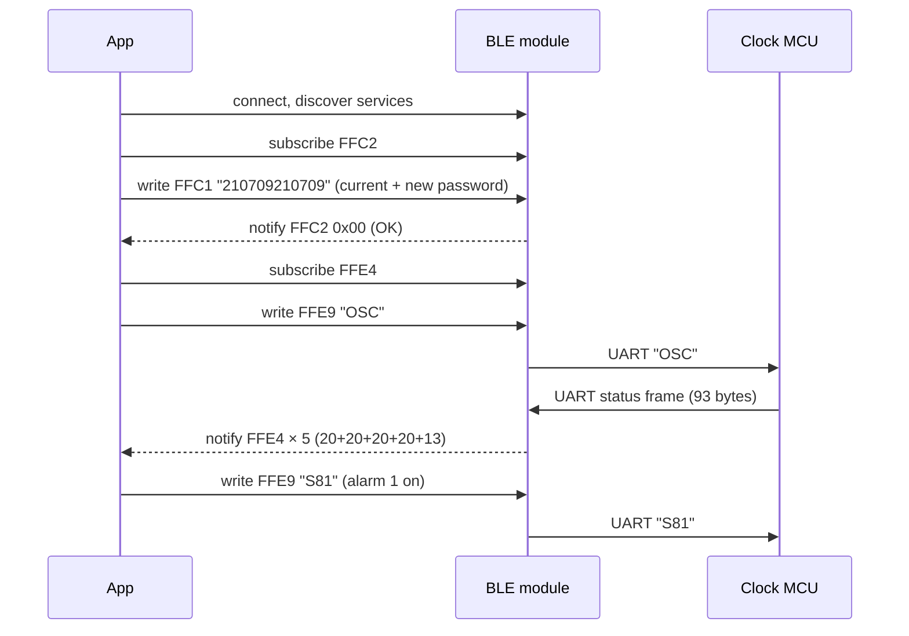

# Guoran nixie clock: Bluetooth protocol

Reverse-engineered from the vendor app [`guoran.apk`](https://diym.vip/upload/guoran.apk) (package `io.dcloud.H5DD29EBE`, "果然",
version 1.0, code 8), the "V2" Bluetooth app of the diym.vip / GANXIN nixie clocks (4-tube
IN1204M/IN1404M and 6-tube IN1206M/IN1406M), and cross-checked against the
[IN1204M English manual](https://diym.vip/upload/IN1404M_IN1204M_BLE_EN.pdf). The app is a DCloud HTML5+ wrapper. All of its logic is in
`assets/apps/H5DD29EBE/www/js/index.js`, so this document is derived from readable source code,
not from guesswork over packet captures. Where the code leaves something open, it is marked
**inferred** or **unverified**.

Implementations: [`web/protocol.js`](../web/protocol.js) and
[`custom_components/guoran_nixie/protocol.py`](../custom_components/guoran_nixie/protocol.py),
both tested against [`fixtures/protocol-vectors.json`](fixtures/protocol-vectors.json).

## Transport

The clock uses a generic Chinese "TTM" BLE-to-UART module. The module bridges a BLE characteristic
to the clock microcontroller's serial port, and adds an optional "anti-hijack" password service.

| Item | Value |
|---|---|
| Advertised name | starts with `XGGF` (the app shows nothing else): `XGGF-VFD11-4EC305` in the manual, `XGGF-IN1204231115.1` on a 2023 IN1204M |
| Advertised services | `FFF0`, `FFB0` (incomplete list of 16-bit UUIDs, **observed**) |
| Manufacturer data | company `0x5352` (bytes `52 53`, "RS"), then `20 22`, the module's MAC (`BA03574B51C1`) and `05 05 00 01 01 01` (**observed**, meaning unknown) |
| Encoding | plain ASCII in both directions |
| Framing | **none**: the module streams bytes to the clock's UART |

### GATT table

All UUIDs are 16-bit, on the Bluetooth base UUID `0000xxxx-0000-1000-8000-00805f9b34fb`.

| Service | Characteristic | Properties | Use |
|---|---|---|---|
| `FFE5` | `FFE9` | write | commands to the clock |
| `FFE0` | `FFE4` | notify | replies from the clock (status frames) |
| `FFC0` | `FFC1` | write | password |
| `FFC0` | `FFC2` | notify | password result (one byte) |
| `FFF0` | `FFF1`–`FFF3` | | module GPIO; unused by the app |
| `FF90`, `FD00` | | | present on the 2023 IN1204M, unused by any app (**observed**) |
| `180A` | `2A23`, `2A26`, `2A27`, `2A29` | read | Device Information (system ID, firmware, hardware, manufacturer) |

The table is confirmed on a 2023 IN1204M with `chrome://bluetooth-internals` on macOS. The clock's
address is `BA:03:57:4B:51:C1`, the one Android sees and the one inside its advertisement. Chrome
on macOS showed `B8:8E:23:74:58:AA` instead: macOS hides Bluetooth addresses, so Chrome shows the
first 6 bytes of a SHA-256 of the system's device identifier
(`GetPeripheralHashAddress` in Chromium's `bluetooth_low_energy_device_mac.mm`). Home Assistant
identifies a clock by its address, so if that ever changed, the clock would be discovered again
as a new device (**unverified**: whether it stays the same after unplugging the clock).

### Service discovery on Android

On a Pixel 9, Android never lists the clock's services: nRF Connect's *Client* tab stays empty,
and the clock drops the connection about 20 s after connecting (**observed**). Web Bluetooth
fails the same way ("No Services matching UUID 0000ffe0…", or the web app's "dropped the
connection"). The same clock lists every service at once to Chrome on macOS, where the web app
logs in and sets the colour, so the module itself works. The cause is **unknown**: Android's
cached copy of the service list, the module's handling of a newer phone's connection setup, or
the module dropping a phone that has not logged in.

The original app polled the service list every 500 ms, up to 20 times, before giving up, and an
older version of it waited 3 s, which suggests discovery was slow on the phones of its day too.
The web app also polls every 500 ms for up to 5 s, reconnects once, and then reports the services
it saw, or when the clock dropped the connection. Bleak, which Home Assistant uses, completes
discovery as part of connecting.

The original app scanned with a service filter `["ffb0", "fff0"]` and then filtered on the name
prefix. The rewritten apps filter by name only.

### Packet size

With the default MTU of 23, one write or notification carries 20 bytes. Two messages are longer:

- **Status frames (93 bytes)** arrive as several notifications and must be reassembled (see
  below). The original app did not do this. It checked each notification for exactly 93 bytes and
  sent `OSC` again otherwise. So either the module negotiates a larger MTU, or the original app
  never read the settings back on some phones and only sent commands (**unverified**).
- **Time sync (23 bytes)** is split into 20-byte writes. The module forwards bytes to the UART as
  they arrive, so the clock sees one contiguous command.

### Command spacing

Commands carry no terminator, so the clock must delimit them by format or by serial idle time
(**inferred**). Both implementations leave at least 150 ms between commands, status requests
included, so consecutive commands never merge on the UART.

### Finding the services on other modules

The vendor changed Bluetooth modules over time, so the layout above may differ on other clocks.
The original app never compared full UUIDs: it cut characters 4–8 out of each service and
characteristic UUID (`uuid.substring(4, 8)`) and compared those to `ffe0`, `ffe5`, `ffc0`,
`ffe4`, `ffe9` and so on. An older page left in the APK (`index_old.html`) even wrote to the
first characteristic of the 8th service, whatever it was. Web Bluetooth needs the exact service
UUID declared up front, so a clock with another layout shows up as "No Services matching UUID".

To read a clock's layout:

- **`chrome://bluetooth-internals`** in desktop Chrome: *Devices*, start a scan, *Inspect* the
  `XGGF…` entry. It lists every service and characteristic with full UUIDs. This is how the
  table above was confirmed.
- **nRF Connect** (Android): tap the clock's row in *Scanner* for its advertisement and *RAW* data;
  *Connect* opens the services in a new tab next to *Scanner*. The clock accepts one connection
  at a time, so close every other app first, and unplug it for 10 s if it will not connect.

## Session



### Password ("anti-hijack" service)

Write 12 ASCII digits to `FFC1`: the current 6-digit password, then the new one. Writing the same
password twice just logs in. `FFC2` then notifies one **raw byte** (not an ASCII digit):

| Byte | Meaning | Original app's reaction |
|---|---|---|
| `0x00` | password correct | sends `OSC` |
| `0x01` | wrong password | retries `210709210709` |
| `0x02` | password changed | stores it, sends `OSC` |
| `0x03` | password removed | message only |

The module ships with password `000000`. On its first connection, the original app sends
`000000210709` and changes the password to `210709`. Every later connection sends
`210709210709`. A clock used with the original app therefore has password **210709**.

Both rewritten apps first try `<password><password>`. If that is refused, they try
`000000<password>`, which takes over a factory module the same way the original app did. Modules
without the `FFC0` service skip the login.

**Unverified:** whether the module rejects UART writes before a successful login.

## Commands (write to `FFE9`)

| Command | Format | Example | Effect |
|---|---|---|---|
| Colour | `R{ggg}-G{rrr}-B{bbb}` | `R128-G255-B000` (orange) | tube backlight colour, zero-padded decimal; **red and green swapped** (see *Colour*) |
| Toggle | `S{id}{0\|1}` | `S81` | switch a setting (table below) |
| Key | `K{nn}` | `K02` | press a front-panel button (table below) |
| Alarm 1 | `AHH:MMA` | `A07:30A` | set alarm 1 time |
| Alarm 2 | `AHH:MMB` | `A08:15B` | set alarm 2 time |
| Power-on time | `THH:MMO` | `T07:00O` | scheduled power-on |
| Power-off time | `THH:MMC` | `T23:30C` | scheduled power-off |
| Time sync | `$YYYY-MM-DD;HH:MM:SS;0W` | `$2026-10-25;09:03:07;00` | set the clock; `W` = weekday, **Sunday = 0** (JavaScript `getDay()`) |
| Status | `OSC` | | ask for a status frame |

### Toggles

The status frame reports toggles in this order.

| # | id | Setting | Original label |
|---|---|---|---|
| 1–6 | `1`–`6` | backlight of tube 1–6 (4-tube models: 5–6 presumably unused, **unverified**) | 6个灯的控制开关 |
| 7 | `7` | take the time from the phone (menu 01 "Time set": 1 = set automatically over Bluetooth, 0 = manual) | 获取系统时间 (Acquisition system time) |
| 8 | `8` | alarm 1 enabled | 闹钟1 |
| 9 | `9` | alarm 2 enabled | 闹钟2 |
| 10 | `0` | scheduled power on/off enabled | 定时开关机 (Timing switch setting) |
| 11 | `A` | automatic brightness (menu 06: auto, or 10 manual levels) | 亮度自动 (LUX Auto) |
| 12 | `B` | 12-hour format | 使用12小时格式 |
| 13 | `C` | ambient light sensing | 环境光线感应 |
| 14 | `D` | hourly voice chime (menu 11) | 整点语音报时 (On time alarm) |
| 15 | `E` | English voice (menu 17) | 语言使用英语 (Using English) |
| 16 | `F` | sensor switch: the external on/off input for a sensor or DIY peripheral (menu 15, **inferred**) | 使用感应开关 (Inductive switch) |

While toggle `7` was on, the original app sent the time sync command **every second**. The
rewritten apps send it hourly (Home Assistant) or every minute while the page is open (web app).
**Unverified:** whether the clock accepts `$…` with toggle `7` off.

### Keys

The app's buttons mirror the clock's 14-key IR remote. `K01`–`K03` sit under the colour slider
and drive the backlight (**observed** on an IN1204M, 2026-10-28):

| Code | Button | Original UI | Remote key |
|---|---|---|---|
| `K01` | next preset colour, and back to a steady light | `<` | (backlight) |
| `K02` | next backlight effect | `M` | (backlight) |
| `K03` | same as `K01`: the same presets in the same order, not the reverse | `>` | (backlight) |
| `K04` | power | round "close" button | ON-OFF |
| `K05` | back | "back" button | BACK |
| `K06` | plus | `+` | + |
| `K07` | set | `SET` | SET: opens the settings menu |
| `K08` | OK | `OK` | OK |
| `K09` | minus | `-` | − |

`K02` steps through the effects: steady, breathing in the chosen colour, breathing through the
colours, rainbow on all tubes together, and a rainbow with each tube a different colour (more may
follow; whether it wraps back to steady is **unverified**). `K01` or `K03` stops any effect. The
status frame has no field for the effect, so an app cannot read which one is running.

The remote also has VOL, LIGHT, TIME, DATE and TEMP keys that the app does not send. Whether
`K10` and up reach them is **unverified**.

### Settings only reachable through the menu

`K07` (SET) opens the clock's settings menu, and `K06`/`K09`/`K08`/`K05` then work as +, −, OK and
back, with voice prompts. That reaches settings the protocol has no command for (manual, "Set the
project function reference table"):

| Menu | Setting | Values |
|---|---|---|
| 04 | digit transition effect | 0 normal, 1 cross-fade, 2 crossbar, 3 other |
| 05 | colon | 0 off, 1 on |
| 06 | brightness | 0 automatic, 1 ten manual levels |
| 07 | prompt volume | 0 (silent) – 7 |
| 08 | display mode | 1 h:m:s, 2 h:m + weekday, 3 month/day/weekday, 4 custom |
| 12 | night mode | no time announcements below brightness 2 |
| 13 | alarm melody | 1–6 |
| 14 | weekday backlight | backlight colour shows the weekday (red … purple); colour locked |
| 16 | tube protection | 0 off (not recommended), 5–15 minutes |
| 18 | factory reset | 11 resets |

### Colour

The clock lights **green from the `R` field and red from the `G` field**; `B` is blue (**observed**
on an IN1204M: `R255-G000-B000` shows green). The original app sent the colour unswapped, so its
red end of the slider lit green too. The rewritten apps swap the two fields both ways, in commands
and in status frames, so colours below are the colours the clock shows.

The original slider runs from 0 to 1530 around the hue wheel, in six segments of 255. One channel
is always 255 and another is always 0:

| Position | R | G | B |
|---|---|---|---|
| 0–255 | 255 | p | 0 |
| 255–510 | 510−p | 255 | 0 |
| 510–765 | 0 | 255 | p−510 |
| 765–1020 | 0 | 1020−p | 255 |
| 1020–1275 | p−1020 | 0 | 255 |
| 1275–1530 | 255 | 0 | 1530−p |

The app's default was 765 (cyan). **Unverified:** whether the clock accepts colours off the wheel
(arbitrary RGB, dimmed values), and whether `R000-G000-B000` turns the backlight off. The app
handled an all-zero colour in a status frame specially, which suggests the clock can report it.

## Status frame (notify on `FFE4`, after `OSC`)

93 ASCII bytes. The frame is the clock's settings written as the commands that would set them
(**inferred** from the field widths and the original parser), closed by `CSS`:

```
R000-G255-B255 S11S21S30S41S51S61S70S81S90S01SA1SB0SC1SD0SE0SF0 A07:30AA08:15BT07:00OT23:30C CSS
└─ colour ───┘ └─ 16 toggles, 3 bytes each, order of the table ─┘ └─ 4 times, 7 bytes each ──┘ └end┘
```

(The spaces are added here for reading; the frame has none.)

| Bytes | Field | Parsing (as the original app) |
|---|---|---|
| 0–13 | colour `Rggg-Grrr-Bbbb` | the three numbers, red and green swapped as in the command (**inferred**) |
| 14–61 | 16 toggles | 3rd byte of each: `0` off, anything else on |
| 62–89 | alarm 1, alarm 2, power-on, power-off | bytes 1–5 of each: `HH:MM` |
| 90–92 | `CSS` | terminator |

The original app accepted a frame when its length was 93, it started with `R` and it ended with
`CSS`. The rewritten parsers also reject colour channels above 255; such frames are treated as
missing and requested again. A time field that is not a time is reported as unknown instead: an
IN1204M sent `T44:29C` (power-off) and `TG0:84O` (power-on) for times never set, and rejecting
those frames hid every other setting.

### What a real IN1204M sends (2026-10-28, Chrome on macOS)

- **One answer per connection.** The `OSC` sent right after logging in was answered on each of
  three connections, about 0.7–1.6 s later. About a hundred later `OSC`s on the same connections
  were not, including one sent alone 6 s after the first answer. The original app also sent
  `OSC` only after logging in. Both rewritten apps therefore read the settings by reconnecting.
- **Twice.** Each answer arrived twice, 30–60 ms apart, each copy in a single notification (so
  Chrome on macOS negotiated an MTU above 93).
- **The colour is scaled.** One frame read `R112-G077-B000` after the last command
  `R255-G176-B000`: each field × 7/16, rounded. Perhaps the brightness level (**inferred** from
  one frame).
- **Junk in unset fields.** Toggle `C` read `T`, and the power-on and power-off times
  `TG0:84O` and `T44:29C`. The two copies of a frame were identical, so this is what the clock
  holds, not damage in transit.

### Reassembly

Buffer the notifications. Drop bytes before an `R`. Once 93 bytes from that `R` have arrived,
accept them if they end in `CSS`, otherwise drop the `R` and search again. `R` appears nowhere else
in a frame, so a lost or corrupted piece costs at most one frame.

## Hardware status

| Date | Clock | Confirmed |
|---|---|---|
| 2026-10-27 | IN1204M, `XGGF-IN1204231115.1` | advertisement (`FFF0`, `FFB0`, manufacturer data), the GATT table |
| 2026-10-28 | same, web app 0.1.1 in Chrome on macOS | password login; colour command (red and green swapped); `K01`–`K03`; status frame received, but rejected by 0.1.1 for its power-on and power-off times (`TG0:84O`, `T44:29C`) (the original app also showed no settings) |
| 2026-10-28 | same, Pixel 9 (nRF Connect, web app 0.1.1) | no services discovered; disconnect about 20 s after connecting |

Everything else under *Commands*, and all of *Status frame*, still comes from the app's code and
the manual. The tube toggles choose which tubes take the next colour (tubes left out keep theirs). Commands
are often not taken (see open question 10), which made their effect look random.

## Open questions

These can only be settled with the clock itself. The fastest way: enable **Developer options →
Enable Bluetooth HCI snoop log** on the old phone, use every control in the original app, take a
bug report (`adb bugreport`), and open `btsnoop_hci.log` in Wireshark with the filter `btatt`.

1. Notification sizes of the status frame, and whether the module negotiates a larger MTU.
2. Whether UART writes work without the password login.
3. Whether off-wheel RGB values and `R000-G000-B000` are honoured.
4. What toggle `7` (time sync) changes on the clock, compared with a one-off `$…` push.
5. Whether the clock sends anything unprompted (for example after a front-panel button press).
6. Whether `K10`+ exist for VOL, LIGHT, TIME, DATE and TEMP, and the full `K02` effect cycle.
7. What the tube toggles do exactly, which physical tube each one drives, and whether 5 and 6 do
   anything on the 4-tube models.
8. Whether the clock's address changes after unplugging it. To check: in nRF Connect, note the
   address of `XGGF…`, unplug the clock for 10 s, rescan and compare.
9. Why Android (Pixel 9) discovers no services. An HCI snoop log of one connection attempt shows
   where discovery stalls.
10. Why the clock ignores some commands. On 2026-10-28, `K04` (power) and `K02` (mode) often
    took several presses, and a status frame read on reconnecting showed tube 2 off after `S21`
    (sent 0.7 s after an unanswered `OSC`), while `S31` (sent 4 s after one) was kept. Candidates:
    the unanswered `OSC`s upsetting the clock's serial parser, writes dropped between Chrome and
    the module, or the clock missing bytes while busy. The web app no longer sends `OSC` after
    each command, which tests the first.
