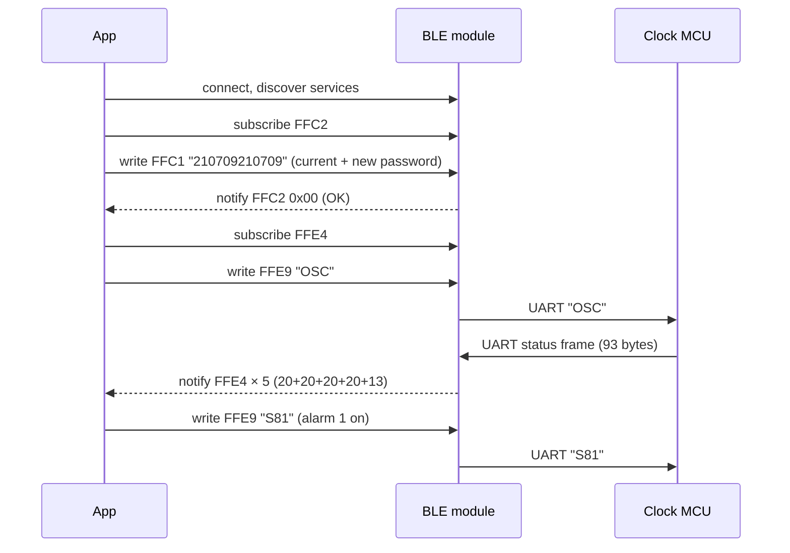

# Guoran nixie clock: Bluetooth protocol

Reverse-engineered from the vendor app [`guoran.apk`](https://diym.vip/upload/guoran.apk) (package `io.dcloud.H5DD29EBE`, "果然",
version 1.0, code 8), the "V2" Bluetooth app of the diym.vip / GANXIN nixie clocks (4-tube
IN1204M/IN1404M and 6-tube IN1206M/IN1406M), and cross-checked against the
[IN1204M English manual](https://diym.vip/upload/IN1404M_IN1204M_BLE_EN.pdf). The app is a DCloud HTML5+ wrapper. All of its logic is in
`assets/apps/H5DD29EBE/www/js/index.js`, so this document is derived from readable source code,
not from guesswork over packet captures. Where the code leaves something open, it is marked
**inferred** or **unverified**.

Implementations: [`web/protocol.js`](../web/protocol.js) and
[`custom_components/guoran_nixie/protocol.py`](../custom_components/guoran_nixie/protocol.py),
both tested against [`fixtures/protocol-vectors.json`](fixtures/protocol-vectors.json).

## Transport

The clock uses a generic Chinese "TTM" BLE-to-UART module. The module bridges a BLE characteristic
to the clock microcontroller's serial port, and adds an optional "anti-hijack" password service.

| Item | Value |
|---|---|
| Advertised name | starts with `XGGF` (the app shows nothing else); the manual shows `XGGF-VFD11-4EC305` |
| Encoding | plain ASCII in both directions |
| Framing | **none**: the module streams bytes to the clock's UART |

### GATT table

All UUIDs are 16-bit, on the Bluetooth base UUID `0000xxxx-0000-1000-8000-00805f9b34fb`.

| Service | Characteristic | Properties | Use |
|---|---|---|---|
| `FFE5` | `FFE9` | write | commands to the clock |
| `FFE0` | `FFE4` | notify | replies from the clock (status frames) |
| `FFC0` | `FFC1` | write | password |
| `FFC0` | `FFC2` | notify | password result (one byte) |
| `FFF0` | `FFF1`–`FFF3` | | module GPIO; unused by the app |

The original app scanned with a service filter `["ffb0", "fff0"]` and then filtered on the name
prefix. The rewritten apps filter by name only.

### Packet size

With the default MTU of 23, one write or notification carries 20 bytes. Two messages are longer:

- **Status frames (93 bytes)** arrive as several notifications and must be reassembled (see
  below). The original app did not do this. It checked each notification for exactly 93 bytes and
  sent `OSC` again otherwise. So either the module negotiates a larger MTU, or the original app
  never read the settings back on some phones and only sent commands (**unverified**).
- **Time sync (23 bytes)** is split into 20-byte writes. The module forwards bytes to the UART as
  they arrive, so the clock sees one contiguous command.

### Command spacing

Commands carry no terminator, so the clock must delimit them by format or by serial idle time
(**inferred**). Both implementations leave at least 150 ms between commands, status requests
included, so consecutive commands never merge on the UART.

## Session



### Password ("anti-hijack" service)

Write 12 ASCII digits to `FFC1`: the current 6-digit password, then the new one. Writing the same
password twice just logs in. `FFC2` then notifies one **raw byte** (not an ASCII digit):

| Byte | Meaning | Original app's reaction |
|---|---|---|
| `0x00` | password correct | sends `OSC` |
| `0x01` | wrong password | retries `210709210709` |
| `0x02` | password changed | stores it, sends `OSC` |
| `0x03` | password removed | message only |

The module ships with password `000000`. On its first connection, the original app sends
`000000210709` and changes the password to `210709`. Every later connection sends
`210709210709`. A clock used with the original app therefore has password **210709**.

Both rewritten apps first try `<password><password>`. If that is refused, they try
`000000<password>`, which takes over a factory module the same way the original app did. Modules
without the `FFC0` service skip the login.

**Unverified:** whether the module rejects UART writes before a successful login.

## Commands (write to `FFE9`)

| Command | Format | Example | Effect |
|---|---|---|---|
| Colour | `R{rrr}-G{ggg}-B{bbb}` | `R255-G128-B000` | tube backlight colour, zero-padded decimal |
| Toggle | `S{id}{0\|1}` | `S81` | switch a setting (table below) |
| Key | `K{nn}` | `K02` | press a front-panel button (table below) |
| Alarm 1 | `AHH:MMA` | `A07:30A` | set alarm 1 time |
| Alarm 2 | `AHH:MMB` | `A08:15B` | set alarm 2 time |
| Power-on time | `THH:MMO` | `T07:00O` | scheduled power-on |
| Power-off time | `THH:MMC` | `T23:30C` | scheduled power-off |
| Time sync | `$YYYY-MM-DD;HH:MM:SS;0W` | `$2026-10-25;09:03:07;00` | set the clock; `W` = weekday, **Sunday = 0** (JavaScript `getDay()`) |
| Status | `OSC` | | ask for a status frame |

### Toggles

The status frame reports toggles in this order.

| # | id | Setting | Original label |
|---|---|---|---|
| 1–6 | `1`–`6` | backlight of tube 1–6 (4-tube models: 5–6 presumably unused, **unverified**) | 6个灯的控制开关 |
| 7 | `7` | take the time from the phone (menu 01 "Time set": 1 = set automatically over Bluetooth, 0 = manual) | 获取系统时间 (Acquisition system time) |
| 8 | `8` | alarm 1 enabled | 闹钟1 |
| 9 | `9` | alarm 2 enabled | 闹钟2 |
| 10 | `0` | scheduled power on/off enabled | 定时开关机 (Timing switch setting) |
| 11 | `A` | automatic brightness (menu 06: auto, or 10 manual levels) | 亮度自动 (LUX Auto) |
| 12 | `B` | 12-hour format | 使用12小时格式 |
| 13 | `C` | ambient light sensing | 环境光线感应 |
| 14 | `D` | hourly voice chime (menu 11) | 整点语音报时 (On time alarm) |
| 15 | `E` | English voice (menu 17) | 语言使用英语 (Using English) |
| 16 | `F` | sensor switch: the external on/off input for a sensor or DIY peripheral (menu 15, **inferred**) | 使用感应开关 (Inductive switch) |

While toggle `7` was on, the original app sent the time sync command **every second**. The
rewritten apps send it hourly (Home Assistant) or every minute while the page is open (web app).
**Unverified:** whether the clock accepts `$…` with toggle `7` off.

### Keys

The app's buttons mirror the clock's 14-key IR remote. `K01`–`K03` sit under the colour slider;
the remote's backlight keys are *1 change colour*, *2 fixed colour* and *3 colour-change mode*, so
these most likely step the backlight (**inferred**, unverified).

| Code | Button | Original UI | Remote key |
|---|---|---|---|
| `K01` | previous backlight colour | `<` | (backlight) |
| `K02` | backlight mode | `M` | (backlight) |
| `K03` | next backlight colour | `>` | (backlight) |
| `K04` | power | round "close" button | ON-OFF |
| `K05` | back | "back" button | BACK |
| `K06` | plus | `+` | + |
| `K07` | set | `SET` | SET: opens the settings menu |
| `K08` | OK | `OK` | OK |
| `K09` | minus | `-` | − |

The remote also has VOL, LIGHT, TIME, DATE and TEMP keys that the app does not send. Whether
`K10` and up reach them is **unverified**.

### Settings only reachable through the menu

`K07` (SET) opens the clock's settings menu, and `K06`/`K09`/`K08`/`K05` then work as +, −, OK and
back, with voice prompts. That reaches settings the protocol has no command for (manual, "Set the
project function reference table"):

| Menu | Setting | Values |
|---|---|---|
| 04 | digit transition effect | 0 normal, 1 cross-fade, 2 crossbar, 3 other |
| 05 | colon | 0 off, 1 on |
| 06 | brightness | 0 automatic, 1 ten manual levels |
| 07 | prompt volume | 0 (silent) – 7 |
| 08 | display mode | 1 h:m:s, 2 h:m + weekday, 3 month/day/weekday, 4 custom |
| 12 | night mode | no time announcements below brightness 2 |
| 13 | alarm melody | 1–6 |
| 14 | weekday backlight | backlight colour shows the weekday (red … purple); colour locked |
| 16 | tube protection | 0 off (not recommended), 5–15 minutes |
| 18 | factory reset | 11 resets |

### Colour

The original slider runs from 0 to 1530 around the hue wheel, in six segments of 255. One channel
is always 255 and another is always 0:

| Position | R | G | B |
|---|---|---|---|
| 0–255 | 255 | p | 0 |
| 255–510 | 510−p | 255 | 0 |
| 510–765 | 0 | 255 | p−510 |
| 765–1020 | 0 | 1020−p | 255 |
| 1020–1275 | p−1020 | 0 | 255 |
| 1275–1530 | 255 | 0 | 1530−p |

The app's default was 765 (cyan). **Unverified:** whether the clock accepts colours off the wheel
(arbitrary RGB, dimmed values), and whether `R000-G000-B000` turns the backlight off. The app
handled an all-zero colour in a status frame specially, which suggests the clock can report it.

## Status frame (notify on `FFE4`, after `OSC`)

93 ASCII bytes. The frame is the clock's settings written as the commands that would set them
(**inferred** from the field widths and the original parser), closed by `CSS`:

```
R000-G255-B255 S11S21S30S41S51S61S70S81S90S01SA1SB0SC1SD0SE0SF0 A07:30AA08:15BT07:00OT23:30C CSS
└─ colour ───┘ └─ 16 toggles, 3 bytes each, order of the table ─┘ └─ 4 times, 7 bytes each ──┘ └end┘
```

(The spaces are added here for reading; the frame has none.)

| Bytes | Field | Parsing (as the original app) |
|---|---|---|
| 0–13 | colour `Rrrr-Gggg-Bbbb` | the three numbers |
| 14–61 | 16 toggles | 3rd byte of each: `0` off, anything else on |
| 62–89 | alarm 1, alarm 2, power-on, power-off | bytes 1–5 of each: `HH:MM` |
| 90–92 | `CSS` | terminator |

The original app accepted a frame when its length was 93, it started with `R` and it ended with
`CSS`. The rewritten parsers also reject colour channels above 255 and impossible times. Garbled
frames are treated as missing and requested again.

### Reassembly

Buffer the notifications. Drop bytes before an `R`. Once 93 bytes from that `R` have arrived,
accept them if they end in `CSS`, otherwise drop the `R` and search again. `R` appears nowhere else
in a frame, so a lost or corrupted piece costs at most one frame.

## Open questions

These can only be settled with the clock itself. The fastest way: enable **Developer options →
Enable Bluetooth HCI snoop log** on the old phone, use every control in the original app, take a
bug report (`adb bugreport`), and open `btsnoop_hci.log` in Wireshark with the filter `btatt`.

1. Notification sizes of the status frame, and whether the module negotiates a larger MTU.
2. Whether UART writes work without the password login.
3. Whether off-wheel RGB values and `R000-G000-B000` are honoured.
4. What toggle `7` (time sync) changes on the clock, compared with a one-off `$…` push.
5. Whether the clock sends anything unprompted (for example after a front-panel button press).
6. Whether `K01`–`K03` are the remote's backlight keys, and whether `K10`+ exist for VOL, LIGHT,
   TIME, DATE and TEMP.
7. Whether toggles 5 and 6 do anything on the 4-tube models.
